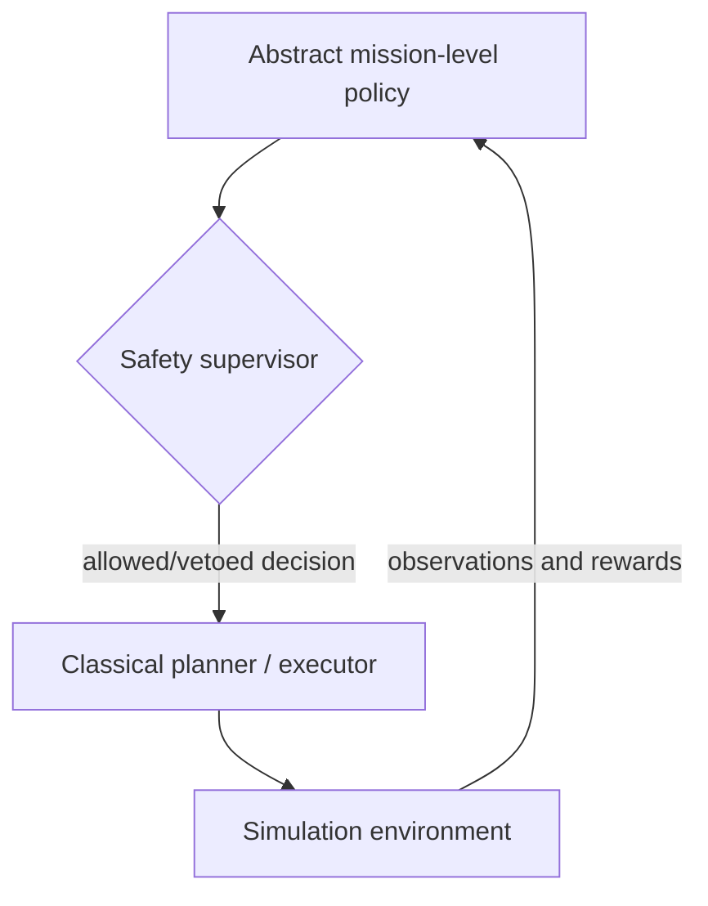

# Facilitator Guide

## Audience and intended outcome

Python-capable engineering students/staff who can run modules in a container. By the last session, each participant should be able to explain the agent/environment boundary, design a valid MDP, train and evaluate a PPO policy, identify reward-design failure modes, distinguish multi-agent behavior from independent single-agent policies, and articulate where a mission-choice policy belongs in an autonomy stack.

## Core architecture

This is **architectural illustration, not an actual A*/MPC connection**. Lesson 6 has a simplified internal executor, not a flight controller. A real system also needs state estimation, constrained guidance, control, verified safety boundaries, and robust communications.

## Before students arrive

- Enter the existing dev container; for Lesson 1, run `uv run --no-sync python -m lessons.lesson01_agent_environment.demo --episodes 1200` and `uv run --no-sync python -m pytest tests/test_lesson01.py -q`. Confirm Ray version equals 2.59.0 before Lessons 3–6.
- Run Lesson 3, 4, 5 and 6 training beforehand on your own machine. Keep checkpoints and screenshots available in the same `outputs/` paths.
- For the live event, teach with `--iterations 2` to prove the interface works; use longer offline checkpoints to discuss behavior, with careful caveats.
- Use same `seed` and number of held-out episodes for fair *within-lesson* comparisons. Multiple independent training seeds strengthen evidence.
- Check CPU / Ray startup and memory once before class. Our examples do not require a GPU and do not change the user's CUDA Torch setup.

## Lesson 1: first show *learning*, not merely controller comparison

The original Lesson 1 compared random, greedy and obstacle-avoidance baselines but did not train an agent. The revised Lesson 1 builds a **tabular Q-learning policy** from an all-zero Q-table and shows how trial and error changes what action the agent picks at a fixed state. Show the identical fixed-start trajectory before and after training and the learning curve. Ask: “Which part of the code stored the route?” The correct answer is **none**: the reward and dynamics shape experience; the learned Q-values determine actions.

Lesson 2 now optionally contains `compare_controllers.py` to discuss fixed heuristics as baselines and to explore when learned methods might help. Lesson 1 requires only NumPy/Matplotlib; no RLlib/GPU startup.

## Common pattern for every 60-minute session

| Time | Activity |
|---:|---|
| 0–10 | One operational question and prediction |
| 10–25 | Walk through interfaces and code |
| 25–50 | Participants modify one design decision and run it |
| 50–60 | Compare metrics, articulate limitations, bridge to next session |

## Assessment strategy

- Ask participants to draw which component computes each variable and where information flows, not to memorize library APIs.
- Require each student to share *a hypothesis, one changed parameter, two measured values, and an interpretation*.
- If a policy fails to learn, that is a legitimate learning outcome: investigate observation adequacy, reward, exploration, number of samples, and environment bugs.
- Avoid claims that an RL policy is reliably safe or suitable for deployment based solely on toy simulations.

## Pedagogical warnings

- The Lesson 1 grid action is a *one-cell discrete move*; the Lesson 2 navigation action is an *instantaneous desired motion direction*. It does not model acceleration, turn radius, bank angle, or flight dynamics.
- Pseudorandom `action_space.sample()` is reproducible only if the action space is seeded (handled by shared rollout helpers).
- Data from the same episodes used for training should not be used to claim holdout performance.
- Lesson 5 simultaneously updates competing PPO policies; the environment is nonstationary from either policy's perspective. Limited iterations often lead to oscillations.
- Mission-level return may hide unsafe proposed commands; compare veto rates and terminal outcome counts separately.

## Suggested extension after session 6

Replace the toy mission executor with an *offline, simulated* interface that accepts constrained command requests and returns simulated execution status; keep the supervisor independent and do not connect the workshop policy to a real vehicle.
