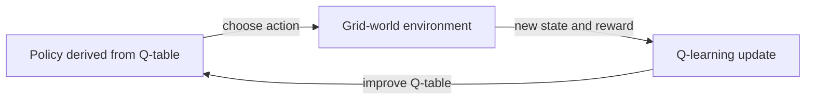
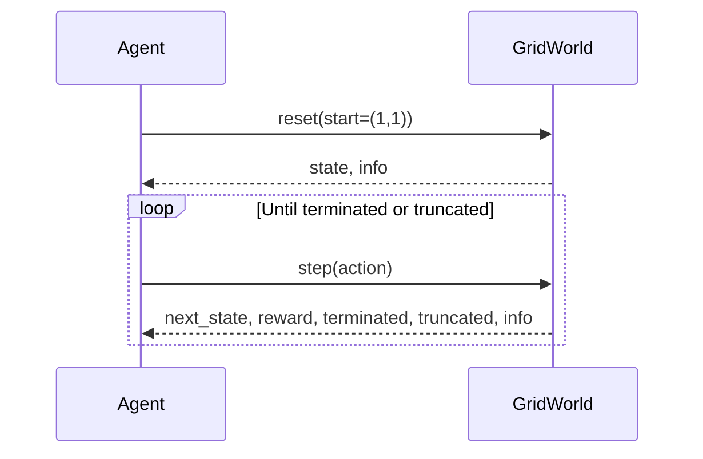
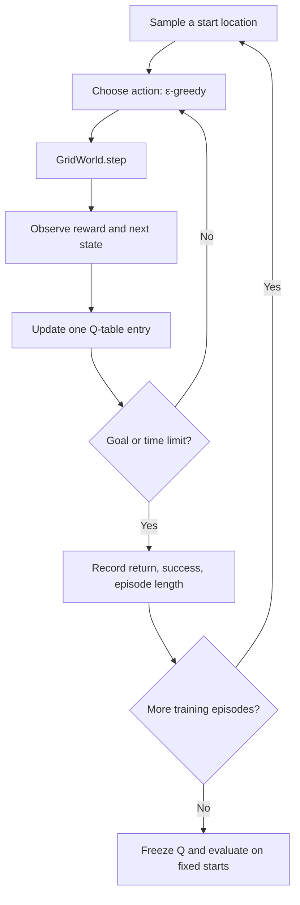
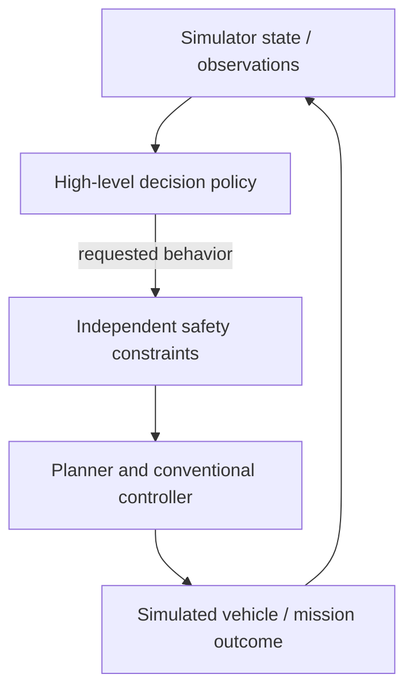

# Lesson 01 — Can a Machine Learn to Navigate?

> **Driving question:** Can an agent learn to reach a goal by trial and error **without us programming the route**?

**Time:** 60 minutes · **Audience:** Python-capable engineering students · **Requires:** NumPy and Matplotlib only for this lesson · **Prior RL knowledge:** None

**One-sentence takeaway:** Reinforcement learning is a process that **changes a policy using experience** to increase expected long-term reward; running a controller that never changes is not, by itself, learning.

This is a **guided lab**, not a reference manual. Before each code cell or command, form a prediction. Then execute, inspect, and explain what changed.

## Learning outcomes

By the end, you should be able to:

1. Explain how an agent observes its environment, selects actions, and receives feedback.
2. Identify **state, action, reward, transition, episode, policy, and return** in executable code.
3. Explain why Q-values change after each trial and why the learned policy takes different actions.
4. Demonstrate **before vs. after** improvement using evaluation starts held fixed between policies.
5. Change **exploration or reward design**, form a testable prediction, and evaluate whether the result supports it.
6. Explain a major limitation of tabular Q-learning for real robotic systems.

### Your deliverable

A screenshot of a **before/after trajectory** or learning curve, one three-row metrics table, and a short explanation answering: *Which line of code taught the agent to go around the wall?*

---

## 0 — Launch the experiment (5 min)

**In your dev container**, navigate to the directory containing `lessons/` and `rl_workshop/` (the workshop root). If those folders are under `src/`, set `PYTHONPATH=src` and run the module from the repository root instead.

```bash
# If lessons/ is at the repository root:
uv run --no-sync python -m lessons.lesson01_agent_environment.demo --episodes 1200

# If lessons/ is under src/:
PYTHONPATH=src uv run --no-sync python -m lessons.lesson01_agent_environment.demo --episodes 1200
```

**What you should see:** a map, the untrained agent's route, the trained agent's route, evaluation metrics, and files in `outputs/lesson01/`:

- `before_after.png`: a fixed start, before vs. after training.
- `learning_curve.png`: rolling training success and exploration probability.
- `learned_policy.png`: arrows showing the greedy action the agent would select in each cell.
- `metrics.csv`: an untrained, random, and trained comparison.
- `training_history.csv`: one row per training episode.
- `q_table.npy`: the numerical knowledge acquired by the agent.

**Do not interpret the output yet.** Write your prediction:

> I expect the trained policy to have a success rate of ______ compared with the untrained policy because ______.

### The maze you are solving

```text
. . . # . . .
. S . # . G .
. . . # . . .
. . . # . . .
. . . . . . .
. . . # . . .
. . . # . . .
```

`S` is the fixed demonstration start; `G` is the goal; `#` is a wall. The opening in the wall is on row 4. During training, starts are sampled from valid cells (not always `S`), so the agent learns more of the map. The comparison plot uses the **same fixed `S`** before and after training.

**Question:** If the shortest line to the goal crosses a wall, what should a successful policy learn to do?

---

## 1 — What exactly is learning? (10 min)

Consider this hand-coded controller:

```python
if goal_is_left:
    action = LEFT
else:
    action = RIGHT
```

It might be a useful *policy*: a mapping from an observation/state to an action. But the rules **do not change with experience**. It is not learning.

Now consider a **Q-table**. It records a value for taking each action in each state. Initially, all entries are zero. Experience updates those values.



During **training**, the Q-table changes. During **evaluation**, we freeze it and check how well the learned policy performs.

**Vocabulary, in context:**

| Term | Meaning in this lesson |
|---|---|
| Agent | The decision-making algorithm and its Q-table |
| Environment | The grid world that applies movement and reward rules |
| State `s` | An integer identifying the agent's current row and column |
| Action `a` | One of `UP`, `RIGHT`, `DOWN`, `LEFT` |
| Transition | Applying an action and moving to the next cell (or staying after hitting a wall) |
| Reward `r` | Numeric feedback for movement, bumping into walls, or arriving at the goal |
| Policy `π(s)` | The action the agent chooses from a given state |
| Episode | One attempt, beginning with `reset()` and ending on arrival or time limit |
| Return | Sum of rewards accumulated during an episode |

**Important:** A neural network is not necessary for RL. Here a plain NumPy array learns the policy.

---

## 2 — Discover the environment API (5 min)

Open `lessons/lesson01_agent_environment/gridworld.py`. Locate `reset` and `step`.



Run this in the [interactive notebook](Lesson_01_Q_Learning.ipynb), or in a Python REPL from the workshop root:

```python
from lessons.lesson01_agent_environment.gridworld import GridWorld

env = GridWorld()
state, info = env.reset(start=(1, 1))
print("State:", state, "Position:", info["position"])

next_state, reward, terminated, truncated, info = env.step(1)  # RIGHT
print(next_state, reward, terminated, truncated, info)
```

**Questions to answer before continuing:**

- Did the agent move right or hit a wall?
- Which function **decided** the movement outcome, `step` or the learning algorithm?
- Why are `terminated` and `truncated` different? (Goal reached vs. episode time limit.)

### Reward specification

The default immediate reward is:

$
r_t = -0.04 - 0.45\,\mathbf{1}[\text{wall bump}]
       + 10\,\mathbf{1}[\text{goal reached}].
$

A movement step costs `−0.04`. Hitting a wall adds a `−0.45` penalty while staying in place. Reaching the goal provides `+10` and ends the episode. Timeout truncates an episode at 45 steps; **timeout is not the same as reaching the goal**.

Why use a step penalty? It gives shorter successful routes a slightly higher return. But the precise behavior depends on all rewards, the discount factor, and learned Q-values. The reward does **not** contain a hard-coded route.

---

## 3 — See an agent that has learned nothing (5 min)

In `q_learning.py` the Q-table starts as zeros:

```python
q = np.zeros((env.num_states, env.num_actions))
```

Every row represents a state; every column represents an action. In the 7×7 maze, the table has shape **49×4** (49 grid IDs × 4 movement actions), including cells occupied by walls; those wall-state rows are never visited.

The untrained policy greedily chooses `argmax(q[state])`. Equal Q-values are broken by choosing the first action (UP). This is a deliberate teaching simplification: it creates a visible failure mode, **not** a recommendation for optimal tie-breaking.

Run:

```bash
uv run --no-sync python -m lessons.lesson01_agent_environment.demo --episodes 1 \
  --output outputs/lesson01_one_episode
```

A one-episode run usually does not learn enough to solve the full problem. Compare its metric results against a longer run.

**Question:** Why can't you claim a controller is learning merely because it receives rewards? What internal value must change?

---

## 4 — The one equation that changes behavior (10 min)

The Q-table estimate is written \(Q(s,a)\): how valuable it is to take action \(a\) in state \(s\), considering potential future rewards.

The update rule is:

$$
\boxed{
Q(s_t,a_t) \leftarrow Q(s_t,a_t)
+ \alpha \underbrace{
\left[
r_t + \gamma \max_{a'} Q(s_{t+1},a')
- Q(s_t,a_t)
\right]
}_{\text{Temporal-difference error}}
}
$$

where \(\alpha\) is the learning rate and \(\gamma\) discounts future rewards. If the goal is reached, the future value is zero. In this implementation a time-limit truncation still bootstraps because the grid task itself continues beyond that artificial rollout limit.

### Work one numerical update by hand

Assume the Q-value for the current state/action is `2.0`, the immediate reward is `−0.04`, the best next-state value is `4.0`, the learning rate is `0.25`, and the discount is `0.97`.

\[
\begin{aligned}
\text{target} &= -0.04 + 0.97(4.0) = 3.84 \\
\text{TD error} &= 3.84 - 2.0 = 1.84 \\
Q_{new} &= 2.0 + 0.25(1.84)=\mathbf{2.46}
\end{aligned}
\]

Execute the same calculation:

```python
q_old = 2.0
reward = -0.04
best_next = 4.0
alpha, gamma = 0.25, 0.97
q_new = q_old + alpha * (reward + gamma * best_next - q_old)
print(q_new)  # 2.46
```

**Point students to these exact lines** in `q_learning.py`:

```python
target = reward + future_value
q[state, action] += alpha * (target - q[state, action])
```

Nothing in this update says "go down to row 4 and cross the wall." Values emerge from rewards collected through repeated transitions.

### Where does exploration come from?

```python
if rng.random() < epsilon:
    return int(rng.integers(q.shape[1]))  # try something
return int(np.argmax(q[state]))            # use what has worked
```

With probability \(\varepsilon\), try an action at random. Otherwise, choose the currently best estimated action. This is **ε-greedy exploration**. Exploration decays from `1.0` toward `0.05` over the first 75% of training.

**Caveat:** Setting ε to zero does not prove no learning can occur in every problem. Initial Q-values and tie-breaking can cause some exploration even under greedy selection. That is a useful experiment rather than a universal rule.

---

## 5 — Observe training and measure change (10 min)

```bash
uv run --no-sync python -m lessons.lesson01_agent_environment.demo --episodes 1200
```

Open `outputs/lesson01/learning_curve.png` and `outputs/lesson01/before_after.png`.



The training success curve is a **rolling average of the most recent 50 episodes**, not a guaranteed monotonic improvement. Exploration makes training noisy and occasionally unsuccessful even when a strong greedy policy exists.

### Compare three policies fairly

The script evaluates all three policies on the **same 60 start positions**, independently of the start positions sampled during training. These are fixed evaluation scenarios, **not a guarantee that every evaluated state was unseen during training**.

| Policy | How action is selected | Updates Q during evaluation? |
|---|---|---|
| Untrained | Greedy over all-zero Q-table | No |
| Random | Uniform random movement | No |
| Trained | Greedy over learned Q-table | No |

Report **success rate**, **mean episode return**, **mean steps**, and **mean wall bumps**. A higher return is not the same statistic as a higher success rate: the reward weights determine how outcomes are valued.

**Question:** Is it convincing to report only the training curve? Why not?

---

## 6 — Inspect what was learned (5 min)

The saved Q-table is a real array that you can print and analyze:

```python
import numpy as np
from lessons.lesson01_agent_environment.gridworld import GridWorld, ACTION_NAMES

env = GridWorld()
q = np.load("outputs/lesson01/q_table.npy")
state = env.encode((1, 1))
print("Q-values at (1,1):", dict(zip(ACTION_NAMES, q[state].round(3))))
print("Best action:", ACTION_NAMES[int(np.argmax(q[state]))])
```

Open `outputs/lesson01/learned_policy.png`. Each arrow corresponds to `argmax Q(s, ·)`. **That pattern is the learned policy.** It may include arrows for cells rarely visited during training; don't infer comprehensive robustness from a pretty plot.

**Questions:**

- Why can two neighboring cells have different preferred actions?
- Does the Q-table contain a precomputed full path, or a choice for each state?
- What happens if the goal or wall placement changes after training?

---

## 7 — Choose ONE controlled experiment (10 min or homework)

Make a prediction **before** changing a command. Keep the random seed fixed, record the exact parameter, and compare on identical evaluation starts.

### Experiment A — Less experience

```bash
uv run --no-sync python -m lessons.lesson01_agent_environment.demo \
  --episodes 30 --output outputs/lesson01_short

uv run --no-sync python -m lessons.lesson01_agent_environment.demo \
  --episodes 1200 --output outputs/lesson01_long
```

Prediction: with fewer updates, Q-values should be less informed. Does the average success rate support that prediction? Why might the exact answer depend on seed and start positions?

### Experiment B — Alter exploration

```bash
uv run --no-sync python -m lessons.lesson01_agent_environment.demo \
  --episodes 75 --epsilon-start 0.0 --epsilon-end 0.0 \
  --output outputs/lesson01_epsilon_zero

uv run --no-sync python -m lessons.lesson01_agent_environment.demo \
  --episodes 75 --epsilon-start 1.0 --epsilon-end 0.05 \
  --output outputs/lesson01_epsilon_default
```

Prediction: How will the two agents discover actions they haven't tried? Watch for exceptions: greedy learning may still explore because initially chosen actions acquire low values.

### Experiment C — Change the reward

```bash
uv run --no-sync python -m lessons.lesson01_agent_environment.demo \
  --episodes 150 --wall-penalty 0 \
  --output outputs/lesson01_wall_penalty_zero

uv run --no-sync python -m lessons.lesson01_agent_environment.demo \
  --episodes 150 --wall-penalty -0.45 \
  --output outputs/lesson01_wall_penalty_default
```

Prediction: Will reduced wall penalties produce more wall bumps? The result can be subtle: even if wall bumps carry no extra penalty, bumping **wastes steps** and still incurs the step cost. Rewards influence behavior but do not always affect it in the way you intuitively expect.

### Extension: Repeat with multiple training seeds

```bash
for seed in 7 11 23; do
  uv run --no-sync python -m lessons.lesson01_agent_environment.demo \
    --episodes 75 --seed "$seed" --output "outputs/lesson01_seed_${seed}"
done
```

Ask whether conclusions are stable across seeds. One impressive screenshot is not a statistically convincing result.

---

## 8 — Debrief (5 min)

Answer in your own words:

1. **Which line of code encoded a path around the wall?** Explain the difference between environment rules, reward specification, and learned decisions.
2. **What changed during training?** Identify the Q-table update and its inputs.
3. **Did training improve task success or just reward?** Use two metrics as evidence.
4. **What would break if you scaled this to a UAV?** Consider continuous states, actions, partial observation, dynamics, disturbances, safety, and simulation-to-real transfer.
5. **What is the point of RL if a hand-coded controller already works?** Discuss adaptability to complex tradeoffs, alongside data/sample cost and safety constraints.

### Connection to autonomy systems



This is an **architectural analogy**, not a working UAV integration. A real aircraft cannot instantaneously move between grid cells; deployment needs dynamics, constraints, verification, and operational safety safeguards. In later sessions, you will move from a Q-table to a neural policy (PPO with RLlib) and ultimately a *toy* mission-level behavior selector.

## Reference and source code guide

| File | What to inspect |
|---|---|
| `gridworld.py` | Environment, grid geometry, reward, `reset()` and `step()` |
| `q_learning.py` | ε-greedy exploration, Q-update, training and evaluation |
| `demo.py` | Command-line parameters, metrics and saved results |
| `plots.py` | Training curve, route comparison and policy visualization |
| `Lesson_01_Q_Learning.ipynb` | Executable guided experiment with prompts |

Recommended reading: Sutton and Barto, *Reinforcement Learning: An Introduction*, 2nd edition, **Chapter 1** (intro) and **Chapter 6.5** (Q-learning). Chapter 3 is useful for formalizing an MDP but is not required for this lab.

**Next lesson:** Formalize the problem using Gymnasium's observation spaces, action spaces, reset/step contracts, and environment validation. The separate continuous-navigation environment in Lesson 2 deliberately changes the task difficulty; it is not a drop-in continuation of this grid Q-table.
