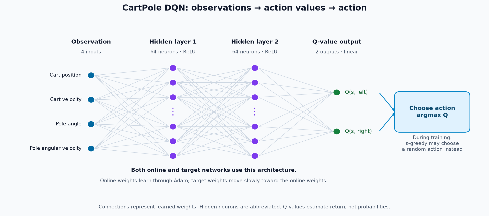

# Lesson 02 — From Q-tables to Deep Q-Networks

**Driving question:** How can an agent learn action values when observations no longer fit neatly into a table?

**Time:** 60 minutes · **Audience:** Python-capable students who completed Lesson 01 · **Neural-network prerequisites:** None · **Hardware:** CPU

Open [the guided notebook](Lesson_02_DQN_Gymnasium.ipynb). As in Lesson 01, students predict, execute, inspect, and explain. The complete DQN implementation is visible in notebook cells.

## Launch

Use the existing workshop environment, which includes PyTorch, `gymnasium[classic-control]`, NumPy, Matplotlib, and JupyterLab. From the repository root:

```bash
uv run --no-sync jupyter lab src/lessons/lesson02_dqn/Lesson_02_DQN_Gymnasium.ipynb
```

If your working directory already contains `lessons/`, open `lessons/lesson02_dqn/Lesson_02_DQN_Gymnasium.ipynb` instead. Select the workshop's Python kernel and use **Restart Kernel and Run All**. Neither Ray/RLlib nor CUDA is used by this lesson. A standalone environment needs `torch`, `gymnasium[classic-control]`, `numpy`, `matplotlib`, and `jupyterlab`.

Rendering uses RGB arrays and inline Matplotlib JavaScript animations, including in headless environments. No video encoder is needed; trust your own notebook if Jupyter suppresses its HTML output. The setup uses one PyTorch CPU thread to avoid overhead on this small network.

## Optional companion: DQN with Ray RLlib

[Lesson_02_DQN_RLlib.ipynb](Lesson_02_DQN_RLlib.ipynb) implements the CartPole example using the project's pinned **Ray RLlib 2.59.0**. This standalone extension runs after the main lesson and adds several minutes of CPU training. The main notebook continues to run without importing Ray.

It maps handwritten DQN components to RLlib's `DQNConfig`, local environment runner, learner, and `RLModule` inference API. It uses the same two 64-unit hidden layers, reward, training seed, and 20 evaluation seeds. To teach basic DQN, it disables Double DQN, dueling, distributional returns, and prioritized replay. The notebook explains its hard target synchronization and lower update frequency relative to the handwritten version; the results are not an exact implementation benchmark.

The companion starts Ray locally with two CPU resources, uses no GPU or remote workers, and shuts down only a runtime it started. Frozen module copies support evaluation and before/after animations after cleanup. Ray's own runtime logs use its normal locations; lesson results go to `outputs/lesson02_rllib/` under the directory containing `lessons/`:

- `training_history.csv`: sampled environment steps and training returns by iteration.
- `metrics.csv`: random, initial untrained, and trained evaluation summaries.
- `rllib_results.png`: training curve and evaluation comparison.
- `Lesson_02_DQN_RLlib_executed.ipynb`: locally executed validation copy.

From the repository root:

```bash
uv run --no-sync jupyter lab src/lessons/lesson02_dqn/Lesson_02_DQN_RLlib.ipynb
```

### RLlib validation result

The complete companion ran in a fresh kernel with Ray 2.59.0, PyTorch 2.11.0+cu128, and Gymnasium 1.2.2 on CPU. Training and evaluation, including Ray startup/cleanup, took 238.7 seconds for 40,000 sampled steps. On the 20 shared evaluation reset seeds, random / untrained / trained mean returns were **26.0 / 9.3 / 121.8**, with episode standard deviations **7.5 / 0.7 / 4.7**. No evaluation episode reached the 500-step cap. These are one training seed's results, not evidence that RLlib outperforms the handwritten implementation.

The full run checks that the initial module remains unchanged, training changes the learned module, and evaluation preserves its weights. The saved notebook includes the comparison plot and both animations. The original handwritten DQN behavior checks also pass.

## Learning outcomes

Students should be able to:

1. Explain the CartPole task, its two discrete actions, four continuous observations, reward, and episode endings using Gymnasium.
2. Derive Q-table growth from those observation dimensions, explain the curse of dimensionality, and distinguish environment dimensions from hidden-layer width.
3. Explain a forward pass, Q-value output, loss, and gradient update without prior neural-network study.
4. Trace a DQN transition through replay, a Bellman target, and an online-network update.
5. Explain replay memory and a slowly updated target network.
6. Compare policies fairly and interpret variability without claiming guaranteed convergence.

## DQN architecture



The online and target networks both map four observations through two 64-neuron ReLU layers to two Q-values. The online network learns through gradient updates; the target network follows through soft updates. The notebook embeds this diagram so it remains visible when the notebook is copied on its own. An [SVG version](assets/dqn_architecture.svg) is also available.

Part 4 also includes an [online/target/loss diagram](assets/dqn_online_target_loss.png), recreated from the supplied reference, and traces how the two networks supply the prediction and target while gradients update only the online network. An [SVG version](assets/dqn_online_target_loss.svg) is available for slides.

## Teaching sequence

| Time | Activity | Evidence of understanding |
|---|---|---|
| 10 min | Meet CartPole and explore Gymnasium | Identify the task, two actions, four observation components, reward, and episode endings; watch random play |
| 5 min | Connect to the Q-table and dimensionality | Derive `bins ** dimensions × actions`, compare resolutions, and explain why dimensions increase table size and experience needs |
| 10 min | Introduce the network | Predict batch/output shapes and compute a simple Huber loss |
| 15 min | Trace one DQN update | Explain replay and target networks; inspect actual weight changes |
| 15 min | Train and evaluate | Read learning curves, compare three policies, inspect before/after animations |
| 5 min | Interpret and submit | Support an improvement claim with metrics and state a limitation |

Training time is included in the experiment segment. Walk through the evaluation design while training runs. Homework and multiple training seeds are optional extensions beyond the core hour.

## Terminology and implementation

| Term | Meaning here |
|---|---|
| Observation | Four floats: cart position/velocity and pole angle/angular velocity |
| Action | Discrete push left or right; standard DQN does not output arbitrary continuous forces |
| Q-network | `4 → 64 → 64 → 2` network predicting discounted action returns, not probabilities |
| Loss / gradient / Adam | Measure prediction error, compute parameter derivatives, then update weights |
| Replay buffer | Up to 10,000 stored transitions sampled uniformly without replacement within a batch |
| Target network | Frozen gradient path, with parameters moved toward the online network after each update |
| Termination | Failure defined by the balancing task; suppresses future value |
| Truncation | External 500-step time limit; ends the rollout while retaining bootstrapping |
| Evaluation | Greedy frozen neural policy or independent random actions, on the same 20 reset seeds |

The default is 40,000 environment steps, 1,000 warmup steps, batch size 128, discount 0.99, Adam learning rate 0.0005, and soft target update rate 0.005. Exploration decays linearly from 1.0 to 0.05 over 20,000 steps. Gradient norm is clipped at 10. Every post-warmup environment step produces one minibatch update. Progress prints every 5,000 steps. The last incomplete episode is omitted from episode-return plots.

The notebook preserves the exact initial weights of the training run. Its isolated one-update demonstration cannot change that baseline. Training seed 7 and evaluation reset seeds 2026–2045 are separate. Reusing seeds improves repeatability within an environment/software configuration; identical results across versions and hardware are not promised.

## Results and student deliverable

Outputs are saved to `outputs/lesson02_notebook/` under the directory containing `lessons/` (normally `src/`, following Lesson 01):

- `learning_curve.png`: training return, exploration, and loss.
- `policy_comparison.png`: mean evaluation return with episode standard deviation.
- `metrics.csv`: random, initial untrained, and trained evaluation summaries.

Submit one plot, the three-policy CSV/table, an advance prediction, and 3–5 sentences interpreting results. The notebook provides prompts and a response template.

In default CartPole, return and episode length are numerically equal because every step gives +1. Error bars describe the spread of evaluation episodes, not uncertainty across independently trained agents or confidence intervals. Time-limit fraction is a descriptive capped-horizon result, not a general success guarantee. The rendered clips show at most 125 frames; evaluation runs complete episodes.

## Instructor guidance

- Introduce CartPole before discussing representation limits. Have students identify its two discrete force actions and four continuous measurements, then use those dimensions to derive table growth. Separate observation dimensions from the chosen width of hidden layers.
- Ask what changed during learning: network parameters now replace Q-table entries. The environment still owns the dynamics and reward.
- Work the target example by hand: ordinary transition 4.96, terminal failure 1.0, external time limit 4.96. Keep the final next observation before resetting.
- Ask why neighboring observations can influence each other's Q-values through shared weights. Generalization can also propagate error.
- Point to `optimizer.step()` and then `soft_update()`. Only the online network receives gradients.
- Decreasing loss does not establish better control. Compare frozen evaluation policies with identical reset seeds.
- DQN is useful for this representation problem; a discretized table, other RL methods, and conventional controllers can also solve CartPole.
- If learning varies, report it. Do not change seeds until an attractive plot appears. The homework comparison fixes the exploration schedule while varying the experience budget.
- When tuning against these evaluation seeds, reserve a separate test set for final claims.

## Validation

Behavior checks execute the learning definitions directly from the notebook, avoiding a duplicate implementation:

```bash
# From repository root:
python -m unittest discover -s src/tests -p test_lesson02.py
```

They check replay ownership and batch dimensions, terminal/time-limit targets, online and target updates, bounded short training, and repeatable evaluation without parameter or gradient changes. Full notebook execution also checks rendering, plots, and the metrics export. A locally executed copy is saved at `outputs/lesson02_notebook/Lesson_02_DQN_Gymnasium_executed.ipynb`, alongside `seed_validation.csv` containing the three-seed validation results.

### Measured teaching configuration

Validated on CPU with PyTorch 2.11.0+cu128 and Gymnasium 1.2.2. Each row uses 40,000 training steps and the same 20 evaluation reset seeds. Timings cover training only on this machine.

| Training seed | Training seconds | Untrained mean return | Trained mean return | Trained episode std. |
|---|---:|---:|---:|---:|
| 7 | 43.7 | 9.30 | 101.0 | 5.0 |
| 11 | 46.6 | 9.35 | 125.7 | 43.7 |
| 23 | 47.2 | 12.35 | 89.7 | 2.6 |

All three runs improved over their initial policies. None reached the 500-step cap during these evaluations. This is a demonstration of learning, not a claim that the default budget reliably solves CartPole. Distinguish variability across training seeds from variability across evaluation episodes. Allow extra time for imports, rendering, and slower classroom hardware.

## References

- [Gymnasium CartPole specification](https://gymnasium.farama.org/environments/classic_control/cart_pole/)
- [Gymnasium basic usage](https://gymnasium.farama.org/introduction/basic_usage/)
- [Gymnasium handling time limits](https://gymnasium.farama.org/tutorials/gymnasium_basics/handling_time_limits/)
- [PyTorch DQN tutorial](https://docs.pytorch.org/tutorials/intermediate/reinforcement_q_learning.html)

**Next connection:** Apply Gymnasium's same interface to the workshop's custom navigation environment, adapting the observation dimension and discrete action count.
